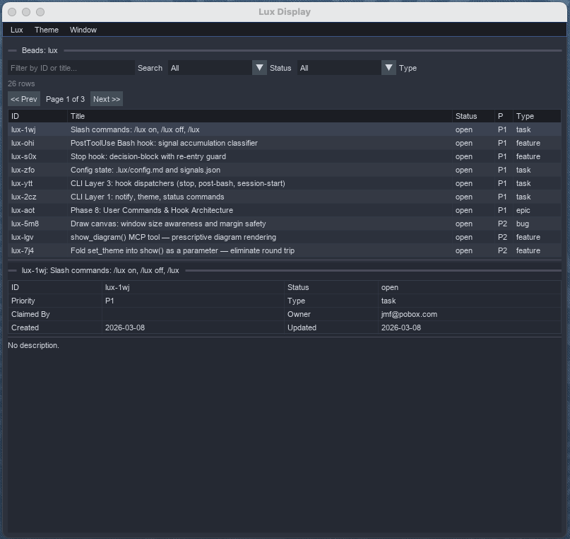
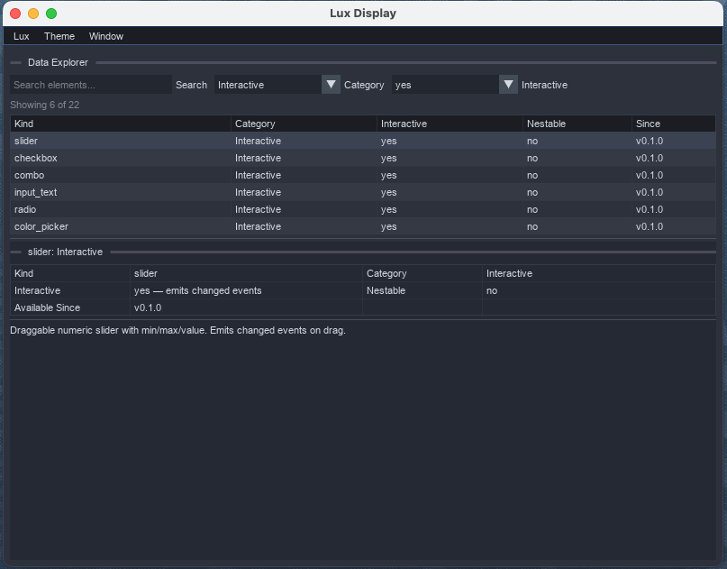
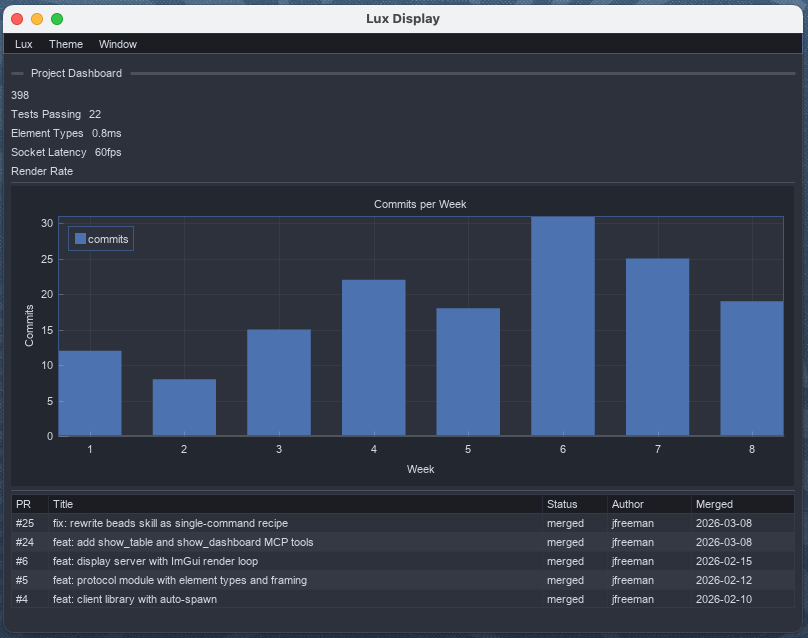

# lux

> A visual output surface for AI agents.

[](LICENSE)
[](https://github.com/punt-labs/lux/actions/workflows/test.yml)
[](https://pypi.org/project/punt-lux/)
[](https://pypi.org/project/punt-lux/)
[](prfaq.pdf)

Lux shows tables, charts, forms, and other UI elements in a desktop window on behalf of AI coding agents such as Claude Code, and on behalf of local Python apps. Agents and apps send a description of the UI as JSON to `luxd`, a background service (the Hub) that keeps the UI's state and runs its click and change handlers. A separate window process (the Display) draws that UI and reports what the user does back to the Hub. Lux ships as a Claude Code plugin, an MCP server, a `lux` command-line tool, and a Python library.

**Platforms:** macOS, Linux

**Stage:** alpha --- published on PyPI as `punt-lux`

## Quick Start

```bash
curl -fsSL https://raw.githubusercontent.com/punt-labs/lux/175b81bc/install.sh | sh
```

Restart Claude Code to activate the plugin. The Lux window opens when an agent sends visual output.

<details>
<summary>Manual install (if you already have uv)</summary>

Install the CLI, the Hub, and the window renderer:

```bash
uv tool install 'punt-lux[display]'
```

Add the Punt Labs plugin marketplace:

```bash
claude plugin marketplace add punt-labs/claude-plugins
```

Install the plugin:

```bash
claude plugin install lux@punt-labs
```

</details>

<details>
<summary>Lightweight install (no window renderer)</summary>

The base package has the `lux` CLI, `luxd-hub`, the Python client library, and the JSON element types. It is enough to drive a running `luxd` from the command line or from Python. It does not include the window renderer (imgui-bundle, numpy, Pillow, PyOpenGL), which comes with the `[display]` extra.

Install the CLI without the renderer:

```bash
uv tool install punt-lux
```

Or add the library to a Python project:

```bash
uv add punt-lux
```

</details>

<details>
<summary>Verify before running</summary>

Download the installer:

```bash
curl -fsSL https://raw.githubusercontent.com/punt-labs/lux/175b81bc/install.sh -o install.sh
```

Print its checksum:

```bash
shasum -a 256 install.sh
```

Read it:

```bash
cat install.sh
```

Run it:

```bash
sh install.sh
```

</details>

<details>
<summary>Homebrew (Apple Silicon macOS)</summary>

The Homebrew formula supports macOS on Apple Silicon (arm64) only. It pins a single macOS arm64 wheel of `imgui-bundle`, the ImGui binding Lux uses for drawing, and `imgui-bundle` publishes no Intel macOS wheel at the pinned version. On Linux or Intel macOS, use the installer above.

```bash
brew install punt-labs/tap/lux
```

`brew install` puts all four Lux executables on `PATH`: `lux` (CLI), `luxd-hub` (Hub service), `luxd-display` (window renderer), and `lux-beads` (the Beads menu applet).

**Use the fully qualified name.** Homebrew Core has an unrelated formula also named `lux` (a Go video downloader). `brew install lux` without the `punt-labs/tap/` prefix installs that one instead, because Homebrew resolves unqualified names against Homebrew Core first.

Use one install method per machine. Homebrew and the `curl | sh` installer put `lux` in different directories, and whichever comes first on `PATH` runs. `command -v lux` shows which one that is.

</details>

## Features

- **25 element kinds** --- text, buttons (arrow, small), images, sliders, checkboxes, combos, inputs (text, number), radios, color pickers (alpha, full picker), selectables, trees, tables, plots, progress bars, spinners, markdown, draw canvases, modals, dialogs, groups, tab bars, collapsing headers, windows, separators
- **Frames** --- a scene can target a named inner window (a frame) with `frame_id`, with an initial size (`frame_size`), ImGui window flags (`frame_flags`), tab or stacked layout (`frame_layout`), and an optional lifetime (`frame_ttl_seconds`)
- **Nested layout** --- windows, tab bars, groups, and collapsing headers can contain any element, to any depth
- **Incremental updates** --- `scene_update` changes individual elements by ID without resending the scene
- **Tabs per scene** --- each `scene_show` call with a new `scene_id` adds a tab to its frame; the same `scene_id` replaces that tab's content; the user can close tabs
- **Composite views** --- `scene_table` builds a searchable, filterable table with a detail panel; `scene_dashboard` builds metric cards, charts, and a table
- **Interaction handling** --- clicks and value changes run their handlers on the Hub, not in the window; `event_ls` lists recent interactions
- **App events** --- agents and apps exchange events on named topics with `topic_subscribe`, `topic_publish`, and `topic_recv`
- **Session menus** --- the menu bar has one submenu per Claude Code session; each lux-enabled session gets a "Beads" entry that opens the issue board
- **Agent menus** --- `menu_set` adds the calling session's own menus; an item either raises one of that session's frames or sends a `lux.menu` event the agent reads with `topic_recv`
- **New content does not take focus** --- a new scene opens a frame if none exists, without taking focus or moving, docking, or reopening other frames
- **Closed frames keep their content** --- closing a frame keeps its scenes, widget state, and selected tab; the dock, Expand All, and the Windows menu reopen it as it was
- **Content is held while no window is connected** --- the Hub never starts or stops the window; while none is connected it holds new content, retries with backoff, and sends everything when a window connects; `lux display link` reports the link state
- **Themes** --- 17 built-in themes, chosen by the user from the window's Settings menu; agents can read the active theme with `display_theme_get` but cannot change it

## What It Looks Like

*A Claude Code session showing a project's issue board. The agent reads the issues with `bd list --json` and sends one `scene_table` call. Filtering and row selection then run inside Lux, with no further tool calls from the agent.*



*The same table and detail layout works for any tabular data: search, combo filters, pagination, and a detail panel from one `scene_table` call.*



*A dashboard of metric cards, charts, and a table. `scene_dashboard` lays it out from structured data, so the agent does not position elements by hand.*



### Show Text and a Button

```json
{"tool": "scene_show", "input": {
  "scene_id": "hello",
  "elements": [
    {"kind": "text", "id": "t1", "content": "Hello from the agent"},
    {"kind": "button", "id": "b1", "label": "Click me"}
  ]
}}
```

The call returns `"shown:hello"` as soon as the Hub accepts the scene. It does not wait for the window to draw it. A click on the button runs its handler on the Hub; the agent does not poll for it. To see recent interactions, read the event log:

```json
{"tool": "event_ls", "input": {"count": 5}}
```

An element that declares `"publish": ["my.topic"]` publishes each user action on that topic: the kind of event, the scene and element it happened on, and the element's own fields, such as a table selection's `row_ids` and `anchor`. A session subscribed with `topic_subscribe` reads these with `topic_recv`. The full event shape is in [the library guide](docs/library.md#what-a-published-event-carries).

### Multi-Window Dashboard

```json
{"tool": "scene_show", "input": {
  "scene_id": "dash",
  "elements": [
    {"kind": "window", "id": "w1", "title": "Controls", "x": 10, "y": 10,
     "children": [
       {"kind": "slider", "id": "vol", "label": "Volume", "value": 50}
     ]},
    {"kind": "window", "id": "w2", "title": "Chart", "x": 320, "y": 10,
     "children": [
       {"kind": "plot", "id": "p1", "title": "Trend",
        "series": [{"label": "y", "type": "line",
          "x": [1,2,3,4], "y": [10,20,15,25]}]}
     ]}
  ]
}}
```

### Update a Single Element

```json
{"tool": "scene_update", "input": {
  "scene_id": "dash",
  "patches": [
    {"id": "vol", "set": {"value": 75}}
  ]
}}
```

## MCP Tools

Agents use Lux through the MCP tools that `luxd` serves at its streamable-HTTP endpoint, `http://127.0.0.1:8430/mcp`. The plugin connects Claude Code to that endpoint.

| Tool | What it does |
|------|-------------|
| **Scenes** | |
| `scene_show(scene_id, elements)` | Show an element tree as a scene, replacing any scene with the same ID. Accepts `frame_id`, `frame_size`, `frame_flags`, `frame_layout`, and `frame_ttl_seconds` |
| `scene_table(scene_id, columns, rows)` | Show a searchable, filterable table with an optional detail panel |
| `scene_dashboard(scene_id, ...)` | Show a dashboard with metric cards, charts, and a table |
| `scene_update(scene_id, patches)` | Change or remove elements by ID |
| `scene_clear(scene_id)` | Remove one of your scenes; an unknown scene or one you do not own returns an error |
| `scene_clear_all()` | Remove all of your scenes |
| **Frames and menus** | |
| `frame_remove(frame_id)` | Remove one of your frames and its scenes; an unknown, foreign, or malformed `frame_id` returns an error |
| `menu_set(menus)` | Replace your session's menus on the menu bar. An item with a `frame_id` raises your frame of that name when clicked; an item without one sends a `lux.menu` event to your `topic_recv()` |
| `menu_ls()` | List the menu bar and its items |
| `callback_register(callback_id, label)` | Register a menu entry owned by the calling connection; only a connection that holds a persistent listener connection (an applet) can register one |
| `callback_pending()` | Show your pending menu-entry clicks without consuming them |
| **Display (read-only; the user controls the window's settings)** | |
| `display_info()` | Backend, resolution, frame rate, PID, and uptime |
| `display_theme_get()` | Active theme and the available themes |
| `display_window_get()` | Window settings: opacity, font scale, decoration, idle frame rate |
| `display_mode_get(repo)` | Whether Lux display mode is on or off for a project; pass the project's absolute path. Set it with `lux display mode on --repo <path>` or `off` |
| `display_state_get()` | Widget and frame state for the scenes you own |
| `display_link_get()` | Whether a window is connected and, if not, how many scenes the Hub is holding, the current retry delay, and the Hub's host and PID |
| `list_frames()` | The window's frames and whether each is on screen, docked, or closed |
| **Introspection** | |
| `scene_inspect(scene_id)` | Element tree of a scene you own |
| `scene_ls()` | Active scenes and frames |
| `session_ls()` | Sessions connected to the Hub |
| `event_ls(count)` | Recent interaction events |
| `error_ls(count)` | Recent errors and warnings |
| **Sessions and topics** | |
| `ping()` | Round-trip latency check |
| `session_identify(kind, name, repo, agent)` | Say who this session is, so the Hub can label the UI it creates |
| `topic_subscribe(topic)` | Subscribe to an app topic; events arrive through `topic_recv` |
| `topic_unsubscribe(topic)` | Stop receiving a topic |
| `topic_publish(topic, payload)` | Publish an app event on a topic |
| `topic_recv()` | Take the next queued topic event without waiting; returns `event:<topic>:<payload>` or `none` |

## Element Kinds

| Category | Kinds |
|----------|-------|
| Display | `text`, `button` (arrow, small variants), `image`, `separator` |
| Interactive | `slider`, `checkbox`, `combo`, `input_text`, `input_number`, `radio`, `color_picker` (alpha, picker modes) |
| Lists | `selectable`, `tree` |
| Data | `table`, `plot`, `progress`, `spinner`, `markdown` |
| Canvas | `draw` (line, rect, circle, triangle, polyline, text, bezier) |
| Layout | `group`, `tab_bar`, `collapsing_header`, `window`, `modal`, `dialog` (confirmation dialog whose buttons run Hub-side handlers) |

All elements with an `id` accept an optional `tooltip` field (text shown on hover).

## CLI Commands

Most commands take the form `lux <noun> <verb>` and use the same names as the MCP tools. Commands that change state accept `--as`, `--kind`, `--name`, `--repo`, and `--agent` to set the caller's identity for that call. Every command accepts `--json`, `--verbose`, and `--quiet`.

| Noun | Verbs |
|---|---|
| `lux scene` | `show`, `update`, `clear`, `clear-all`, `inspect`, `ls`, `table`, `dashboard` |
| `lux frame` | `remove` |
| `lux menu` | `ls`, `set` |
| `lux session` | `ls`, `inspect`, `identify` |
| `lux display` | `info`, `theme`, `state`, `mode`, `window`, `link` |
| `lux event` | `ls` |
| `lux error` | `ls` |
| `lux callback` | `register` |

| Service command | What it does |
|---|---|
| `lux hub install`, `uninstall` | Register or remove `luxd` as a launchd (macOS) or systemd user (Linux) service |
| `lux hub start`, `stop`, `restart`, `status` | Control and report on the `luxd` service |
| `lux hub doctor` | Find legacy registrations and port conflicts; `--fix` repairs them |
| `lux display install`, `uninstall` | Register or remove the window as a launchd or systemd user service that starts at login and restarts after a crash |
| `lux display start`, `stop`, `restart`, `status` | Control and report on the window service |
| `lux display doctor` | Find legacy registrations and port conflicts; `--fix` repairs them |
| `lux display serve` | Run the window in the foreground (the service runs the same entry point) |

The installer runs `lux display install` for you. On macOS the window gets a Dock icon.

| Command | What it does |
|---|---|
| `lux ping` | Ping the window through `luxd` and print the round-trip time |
| `lux doctor` | Check installation health: Python version, the display packages, fonts, and the Claude Code plugin |
| `lux version` | Print the version |
| `lux enable` | Enable visual output for this project and add Lux's permission rules to `.claude/settings.json` ([rule list](docs/user-guide.md#permission-rules)) |
| `lux disable` | Disable visual output for this project and remove those rules |
| `lux status` | Check whether the window is running |
| `lux install` | Install the Claude Code plugin from the marketplace |
| `lux uninstall` | Uninstall the Claude Code plugin |
| `lux beads` | Show the repository's beads issue board, with no agent involved (`--all` includes closed issues) |
| `lux-beads` | The Beads menu applet; the plugin's session-start hook runs it for each session |

The topic tools and `callback_pending` are MCP-only and have no CLI command.

## Library (Python)

Python applications drive the Hub through `LuxClient`, a typed async client for `luxd`'s REST API. It applies the same validation and identity handling as the CLI and does not need the `[display]` extra. Long-running apps add `LuxHubClient` to receive menu clicks and topic events over a persistent connection. The [Python Library Guide](docs/library.md) has working examples.

## Terminal spike (experimental)

The spike branch provides a separate foreground terminal owner, `luxd-pty`.
It requires the headless `terminal` extra, not the GPU dependencies:

```bash
uv run --extra terminal luxd-pty
```

It binds `~/.punt-labs/lux/pty/luxd-pty.sock` in a private directory. Use
`--socket` for an isolated instance with a short Unix-socket pathname.
Clients must have the same OS UID and negotiate matching wire/snapshot
versions. Sessions survive client disconnects; stopping the daemon ends them.
An occupied endpoint is refused, not automatically removed.

The terminal element now attaches to this daemon instead of owning a PTY in
the Display. Start the daemon manually before showing terminals. Set
`LUX_PTY_SOCKET` on the Display to use an isolated endpoint. Display exit
releases its replicas and connection, not the held programs.

Several viewers may attach to the same session. Output is credit-controlled
per viewer; a stalled viewer receives a fresh snapshot instead of an
unbounded backlog. The last viewer to type or request a resize sets the grid.
Automatic daemon startup is still later work.
See the [step-4 plan](spikes/terminal/STEP4-PLAN.md).

## Architecture

```text
Agent or app
  │ MCP tools, CLI, or Python library (HTTP)
  ▼
luxd (Hub)
  │ holds scenes and runs handlers
  │ sends scenes; receives clicks and changes
  ▼
Lux window (ImGui + OpenGL)
  │ draws at 60fps
  ▼
Window on screen
```

`luxd` runs as a user service on your machine and listens only on loopback. It stores every scene and runs every handler. The Lux window draws what the Hub sends and reports clicks and value changes back to it; restarting the window does not lose the scenes. Each Claude Code session also runs `lux-beads`, a small helper started by the plugin's session-start hook, which owns that session's Beads menu entry and exits when the session ends. More detail is in the [user guide](docs/user-guide.md).

## Acknowledgements

Rendering uses [Dear ImGui](https://github.com/ocornut/imgui), Omar Cornut's immediate-mode GUI library, which handles text layout, widget state, input, and GPU drawing. The Python bindings come from [imgui-bundle](https://github.com/pthom/imgui_bundle) by Pascal Thomet, which packages ImGui, ImPlot, and other ImGui extensions as one wheel with type stubs. [FastMCP](https://github.com/jlowin/fastmcp) provides the MCP server layer.

## Documentation

[User Guide](docs/user-guide.md) |
[Python Library Guide](docs/library.md) |
[Docs Guide](docs/README.md) |
[Target Architecture](docs/architecture/target/target.md) |
[Current Architecture](docs/architecture/system.tex) |
[Design Log](DESIGN.md) |
[PR/FAQ](prfaq.pdf) |
[Contributing](CONTRIBUTING.md) |
[Changelog](CHANGELOG.md)

## License

MIT
